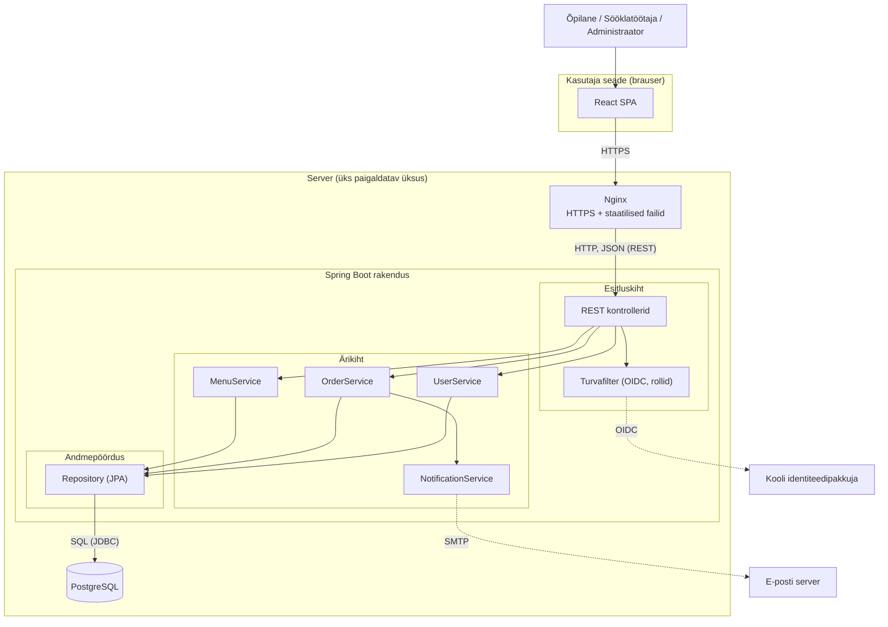

# 4. Tarkvaraarhitektuur

## 4.1 Rakenduse tüüp

**Veebirakendus** (brauseris töötav ühelehe rakendus + serveripoolne API).

Põhjendus: õpilased kasutavad nii telefoni kui arvutit; veebirakendust ei pea installima ega poodidest uuendama, seega saab kogu kooli kiiresti kasutama panna. Natiivne mobiilirakendus oleks kallim (kaks platvormi) ja esimeses versioonis ebavajalik.

## 4.2 Valitud arhitektuur: kihiline monoliit

Üks serverirakendus (Spring Boot) koosneb kolmest kihist, mis on paigaldatavad ühe üksusena:

1. **Esitluskiht** – REST kontrollerid, turvafilter (sisselogimine ja rollikontroll). Võtab vastu HTTP päringuid ja tagastab JSON-it.
2. **Ärikiht** – teenused (`MenuService`, `OrderService`, `UserService`, `NotificationService`). Siin on ärireeglid (nt tellimuse tähtaeg 09:30).
3. **Andmepöördus** – repositooriumid (Spring Data JPA), räägivad PostgreSQL-iga.

Kiht võib kutsuda ainult enda all olevat kihti. Kasutajaliides (React SPA) on eraldi ja suhtleb API-ga.

## 4.3 Arhitektuuriskeem

Muudetavad lähtefailid (skeem ei ole ainult pilt):

- **diagrams.net:** [diagrams/architecture.drawio](../diagrams/architecture.drawio) (ava aadressil <https://app.diagrams.net> → *Open from Device*)
- **PlantUML:** [diagrams/architecture.puml](../diagrams/architecture.puml)
- Täiendavad skeemid: [kasutusjuhud](../diagrams/usecase.puml), [andmemudel](../diagrams/er-model.puml), [tellimuse andmevoog](../diagrams/sequence-order.puml)

Allolev Mermaid-eelvaade renderdub otse GitHubis; sisu vastab lähtefailidele.

## 4.4 Kuidas andmed liiguvad

Näide: õpilane esitab tellimuse (täpne jadadiagramm: [sequence-order.puml](../diagrams/sequence-order.puml)).

1. **Kasutajaliides → server.** Õpilane vajutab "Telli". React saadab `POST /api/orders` (JSON: toidud, kogused, lõunaaeg) ja sisselogimisel saadud tokeni HTTPS kaudu.
2. **Nginx → kontroller.** Nginx edastab päringu Spring Boot rakendusele.
3. **Turvafilter.** Kontrollib tokeni ja rolli (õpilane tohib tellida).
4. **Kontroller → teenus.** Kontroller teisendab JSON-i objektiks ja kutsub `OrderService.placeOrder(...)`.
5. **Ärikiht.** Teenus kontrollib reegleid (tähtaeg 09:30, toit on menüüs, kogus > 0). Vea korral tuleb vastuseks `409 Conflict` ja veateade.
6. **Andmepöördus.** Repository salvestab tellimuse (`INSERT` tabelitesse `orders` ja `order_item`) PostgreSQL-i ühes tehingus (transaction).
7. **Vastus.** Andmebaas → repository → teenus → kontroller → `201 Created` + JSON → React näitab kinnitust.
8. **Kõrvalmõju.** Kui tellimus hiljem märgitakse valmis, saadab `NotificationService` e-kirja SMTP serveri kaudu.

Menüü lugemise suund on samasugune, kuid `GET` päringuga ja ilma kirjutamiseta.

## 4.5 Valitud arhitektuuri eelised ja puudused

| Eelised | Puudused |
|---|---|
| Lihtne arendada ja siluda (üks projekt, üks käivitus) | Kogu rakendust tuleb skaleerida korraga, mitte üksikuid osi |
| Lihtne paigaldada ja hooldada (üks serveriprotsess, üks andmebaas) | Kui kood kasvab suureks, võib see muutuda raskesti hallatavaks |
| Tehingud andmebaasis on lihtsad (kõik ühe protsessi sees) | Üks tõsine viga võib kogu rakenduse maha võtta |
| Madal infrastruktuuri kulu, sobib ühele arendajale | Tehnoloogiat on raske osade kaupa vahetada |
| Kihid hoiavad vastutuse selgena (testitavus) | Kihtide vahel võib tekkida liigset "läbi-kutsumist" |

## 4.6 Võrdlus alternatiiviga: mikroteenused

| Kriteerium | Kihiline monoliit (valitud) | Mikroteenused |
|---|---|---|
| Ülesehitus | Üks paigaldatav üksus | Mitu väikest sõltumatut teenust (nt menüü, tellimused, kasutajad), igaühel oma andmebaas |
| Arenduse keerukus | Madal | Kõrge (teenuste vahelised päringud, tõrkekäsitlus, jälgimine) |
| Paigaldus | Üks serveri-paigaldus | Palju teenuseid, vaja konteinerid/orkestreerimine (Docker, Kubernetes) |
| Skaleeritavus | Kogu rakendus korraga | Iga teenust eraldi |
| Tiimi suurus | Sobib 1–5 inimesele | Sobib mitmele tiimile |
| Andmete järjepidevus | Lihtne (üks andmebaas, tehingud) | Keeruline (hajutatud tehingud) |
| Kulu | Madal | Kõrge |

**Miks mikroteenused ei sobi:** ~600 kasutajaga koolirakendus ja üks arendaja ei õigusta mikroteenuste keerukust. Kihiline monoliit annab piisava jõudluse ja jääb hooldatavaks. Kui koormus või tiim oluliselt kasvab, saab hiljem ärikihi osi (nt tellimused) eraldi teenuseks tõsta, sest kihid ja teenused on juba selgelt eraldatud ("modulaarne monoliit").
